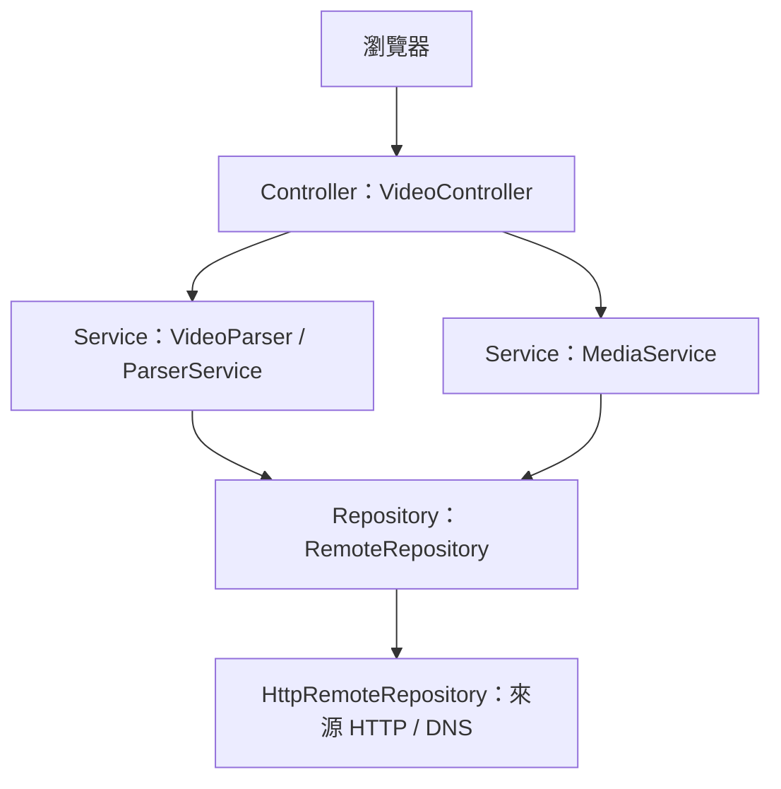

# VIDEO_EXTRACTOR — Java 三層架構

Java 21 / Spring Boot 專案。移植基準是目前公開網站的最後一版 `parser.js`、`media.js`、`worker.js`，原始檔保留在 `reference/`。網頁介面直接沿用現有 HTML。

## 三層與擴充點



- **Controller**：接收網址、檢查請求格式、輸出 JSON 與影片串流，保持 `/api/inspect`、`/api/media`、`/api/download` 路徑。
- **Service**：負責解析優先順序、第一個來源選擇、Referer 重試與 HLS 合併。`VideoParser` 可替換實作，Controller 不依賴解析器的具體類別。
- **Repository**：`RemoteRepository` 隔離外部 HTTP / DNS，便於替換 HTTP 客戶端、設定測試替身。第三層為外部來源存取，現有功能不需要資料庫，因此沒有新增資料庫。
- **model / policy**：DTO、例外與共用網址規則，避免 Repository 依賴上層 Service。

## 保留的行為

1. videourls → 雙向混淆陣列 A/B → video/source → Open Graph → HTML 文字網址，順序不變。
2. 陣列必須等長，先測取用順序 A，再測位置排列 B。
3. 原版混淆適配器會截斷 `.mp4` / `.m3u8` 後面的查詢參數；Java 版保留此行為，未擅自修正。
4. `inspect` 只回傳第一部影片第一個来源，直接 MP4/M3U8 網址走原本的直接來源分支。
5. 空來源過濾、去重、公開網址 / IP 檢查、DNS、重新導向、8 MB HTML 與 1 MB HLS 限制。
6. 首頁 Referer → 完整頁面 Referer → 不傳 Referer；錯誤診斷保留 URL、實際 URL、狀態、類型、內容開頭。
7. HTML/XML/JSON 開頭檢查仍停用；MP4 ftyp 與 video MIME 檢查仍生效。
8. HLS 選最高頻寬，保留加密、直播、MAP/BYTERANGE/DISCONTINUITY 拒絕規則，以及最多 1500 段 / 4 GB。

## 啟動

安裝 Java 21 與 Maven 3.9 後：

```sh
mvn clean package
java -jar target/video-parser-1.0.0.jar
```

瀏覽 `http://localhost:8080`。可用環境變數 `PORT` 更改連接埠。

也可使用 Docker：

```sh
docker compose up -d --build
```

Compose 設定 `restart: unless-stopped`。主機開機且 Docker 服務持續運行時，容器會重新啟動。對外服務可使用 VPS 或支援 Java / Docker 的主機，並由反向代理提供 HTTPS。

HTTPS 反向代理需保留外部 Host，並在**可信任的代理環境**設定 `SERVER_FORWARD_HEADERS_STRATEGY=framework`，讓同源檢查取得正確的 HTTPS Origin。避免把使用者提供的 forwarded headers 直接當作可信任主機資訊。

## 驗證

```sh
mvn test
```

`parser-fixtures.json` 的 22 組預期結果由原版 JavaScript 實際執行產生，包括 A/B 混淆、等長限制、查詢參數截斷、無效百分比解碼、空來源、OG、文字來源與集數。JUnit 逐一比較 Java 結果；另驗證第一部影片、公開位址、Referer、錯誤診斷、停用的 HTML 檢查、HLS 與 HTTP 合約。

跨語言 HTTP、HTML 與 URL 函式庫不同，這些回歸案例提供已驗證的相容範圍，不代表所有未測試的畸形 HTML、URL 或特殊來源都能保證相同。實際網站若有差異，應先新增原版預期案例，再調整 Java 相容實作，不應直接改動解析規則。

## 部署範圍

本專案為 Java 原始碼及可獨立執行的服務。現有 `chatgpt.site` 網站仍是原 JavaScript 版，沒有替换線上解析器。此 JAR 需 Java / Docker 主機；不是可直接上傳至現有 Cloudflare Worker 的封裝。

公開網址檢查與 DNS 查詢不能取代主機的網路層出站限制。公開部署沿用現有來源代理能力時，應在部署平台設定對應的出站與存取限制。


Google Drive：支援每位使用者 OAuth 連線、資料夾管理與指定位置上傳，設定請參閱 [GOOGLE_DRIVE_SETUP.md](GOOGLE_DRIVE_SETUP.md)。
